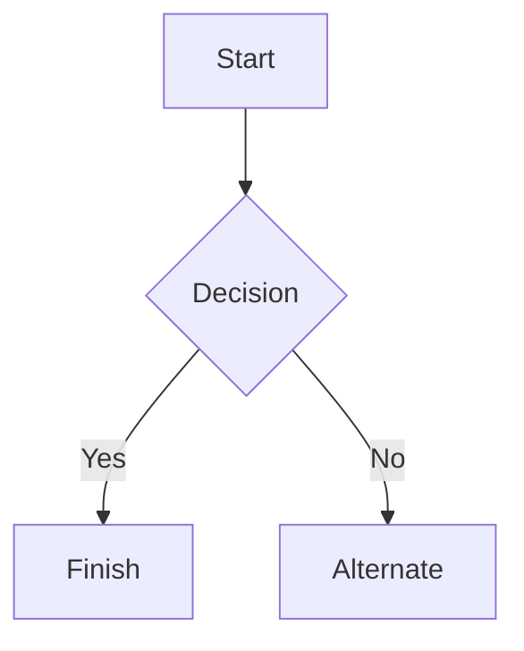

# Markdown syntax guide

## Headers

# This is a Heading h1
## This is a Heading h2
###### This is a Heading h6

## Emphasis

*This text will be italic*  
_This will also be italic_

**This text will be bold**  
__This will also be bold__

_You **can** combine them_

## Lists

### Unordered

* Item 1
* Item 2
* Item 2a
* Item 2b
    * Item 3a
    * Item 3b

### Ordered

1. Item 1
2. Item 2
3. Item 3
    1. Item 3a
    2. Item 3b

## Images


## Links

You may be using [Markdown Live Preview](https://markdownlivepreview.com/).

## Blockquotes

> Markdown is a lightweight markup language with plain-text-formatting syntax, created in 2004 by John Gruber with Aaron Swartz.
>
>> Markdown is often used to format readme files, for writing messages in online discussion forums, and to create rich text using a plain text editor.

## Tables

| Left columns  | Right columns |
| ------------- |:-------------:|
| left foo      | right foo     |
| left bar      | right bar     |
| left baz      | right baz     |

## Blocks of code

```
let message = 'Hello world';
alert(message);
```

## Mermaid diagrams


## Inline code

This web site is using `markedjs/marked`.

# Art Database API
## Overview

This Node API fetches data about various artists, paintings, galleries, eras, and genres. The database is hosted on Supabase and returns JSON

## Built with
 
- **Node.js**: JS runtime
- **Express**: routing
- **Supabase**: cloud hosted database
- **Vercel**: site hosting - https://comp4513-assig1.vercel.app/

## API Endpoints
 
| Endpoint  | Description |
| ------------- |:-------------:|
| `/api/eras` | Get all eras |
| `/api/galleries` | Get all galleries |
| `/api/galleries/:ref` | Get a gallery by reference |
| `/api/galleries/country/:substring` | Get galleries whose country begins with the substring |
| `/api/artists` | Get all artists |
| `/api/artists/:ref` | Get an artist by reference |
| `/api/artists/search/:substring` | Get artists whose last name begins with the substring |
| `/api/artists/country/:substring` | Get artists whose nationality begins with the substring |
| `/api/genres` | Get all genres, with full era details |
| `/api/genres/:ref` | Get a genre by reference |
| `/api/genres/painting/:ref` | Get the genres used in a painting |
| `/api/paintings/single/:ref` | Get a painting by ID |
| `/api/paintings/sort/:sortBy/limit/:ref` | Get paintings sorted by `title` or `year`, limited by reference results (`0` gets all) |
| `/api/paintings/sort/:sortBy/limit/:ref/skip/:ref2` | Get paintings sorted by `title` or `year`, limited by reference results (`0` gets all) skipping the first reference2 paintings |
| `/api/paintings/search/:substring` | Get paintings whose title contains the substring |
| `/api/paintings/years/:start/:end` | Get paintings made between and including two years |
| `/api/paintings/galleries/:ref` | Get all paintings in a gallery |
| `/api/paintings/artist/:ref` | Get all paintings by an artist |
| `/api/paintings/genre/:ref` | Get paintings in a genre |
| `/api/paintings/era/:ref` | Get paintings in an era |
| `/api/counts/genres` | Painting count per genre |
| `/api/counts/artists` | Painting count per artist |
| `/api/counts/topgenres/:ref` | Genres with more than the reference paintings |

## Test Links
 
### Eras and galleries
 
- [/api/eras](https://comp4513-assig1.vercel.app/api/eras)
- [/api/galleries](https://comp4513-assig1.vercel.app/api/galleries)
- [/api/galleries/30](https://comp4513-assig1.vercel.app/api/galleries/30)
- [/api/galleries/calgary](https://comp4513-assig1.vercel.app/api/galleries/calgary)
- [/api/galleries/country/fra](https://comp4513-assig1.vercel.app/api/galleries/country/fra)
### Artists
 
- [/api/artists](https://comp4513-assig1.vercel.app/api/artists)
- [/api/artists/12](https://comp4513-assig1.vercel.app/api/artists/12)
- [/api/artists/1223423](https://comp4513-assig1.vercel.app/api/artists/1223423)
- [/api/artists/search/ma](https://comp4513-assig1.vercel.app/api/artists/search/ma)
- [/api/artists/search/mA](https://comp4513-assig1.vercel.app/api/artists/search/mA)
- [/api/artists/country/fra](https://comp4513-assig1.vercel.app/api/artists/country/fra)
### Genres
 
- [/api/genres](https://comp4513-assig1.vercel.app/api/genres)
- [/api/genres/76](https://comp4513-assig1.vercel.app/api/genres/76)
- [/api/genres/painting/408](https://comp4513-assig1.vercel.app/api/genres/painting/408)
- [/api/genres/painting/jsdfhg](https://comp4513-assig1.vercel.app/api/genres/painting/jsdfhg)
### Paintings
 
- [/api/paintings/single/63](https://comp4513-assig1.vercel.app/api/paintings/single/63)
- [/api/paintings/sort/title/limit/10](https://comp4513-assig1.vercel.app/api/paintings/sort/title/limit/10)
- [/api/paintings/sort/year/limit/10](https://comp4513-assig1.vercel.app/api/paintings/sort/year/limit/10)
- [/api/paintings/sort/absd/limit/10](https://comp4513-assig1.vercel.app/api/paintings/sort/absd/limit/10)
- [/api/paintings/sort/year/limit/asd](https://comp4513-assig1.vercel.app/api/paintings/sort/year/limit/asd)
- [/api/paintings/sort/year/limit](https://comp4513-assig1.vercel.app/api/paintings/sort/year/limit)
- [/api/paintings/sort/year/limit/10/skip/30](https://comp4513-assig1.vercel.app/api/paintings/sort/year/limit/10/skip/30)
- [/api/paintings/sort/year/limit/10/skip/30000](https://comp4513-assig1.vercel.app/api/paintings/sort/year/limit/10/skip/30000)
- [/api/paintings/sort/year/limit/10/skip](https://comp4513-assig1.vercel.app/api/paintings/sort/year/limit/10/skip)
- [/api/paintings/search/port](https://comp4513-assig1.vercel.app/api/paintings/search/port)
- [/api/paintings/search/pORt](https://comp4513-assig1.vercel.app/api/paintings/search/pORt)
- [/api/paintings/search/connolly](https://comp4513-assig1.vercel.app/api/paintings/search/connolly)
- [/api/paintings/years/1800/1850](https://comp4513-assig1.vercel.app/api/paintings/years/1800/1850)
- [/api/paintings/years/1850/1800](https://comp4513-assig1.vercel.app/api/paintings/years/1850/1800)
- [/api/paintings/galleries/5](https://comp4513-assig1.vercel.app/api/paintings/galleries/5)
- [/api/paintings/artist/16](https://comp4513-assig1.vercel.app/api/paintings/artist/16)
- [/api/paintings/artist/666](https://comp4513-assig1.vercel.app/api/paintings/artist/666)
- [/api/paintings/genre/78](https://comp4513-assig1.vercel.app/api/paintings/genre/78)
- [/api/paintings/era/2](https://comp4513-assig1.vercel.app/api/paintings/era/2)
### Counts
 
- [/api/counts/genres](https://comp4513-assig1.vercel.app/api/counts/genres)
- [/api/counts/artists](https://comp4513-assig1.vercel.app/api/counts/artists)
- [/api/counts/topgenres/20](https://comp4513-assig1.vercel.app/api/counts/topgenres/20)
- [/api/counts/topgenres/2034958](https://comp4513-assig1.vercel.app/api/counts/topgenres/2034958)
